<div align="center">


# Omniweb

**One agentic workspace for software, growth, and engineering design.**

Describe what you want. Omniweb plans it, builds it, verifies it, and keeps every
consequential step behind an approval you control.

[Features](#features) · [Architecture](#architecture) · [Quick start](#quick-start) ·
[Configuration](#configuration) · [Testing](#testing) · [Safety](#safety-and-governance) ·
[Docs](#documentation)

</div>

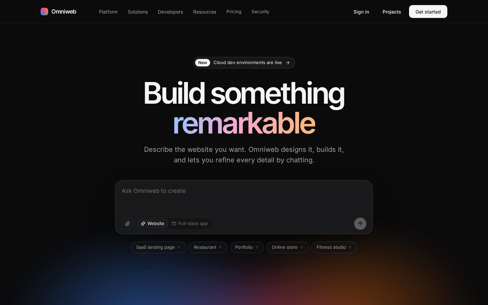

---

## Contents

- [What Omniweb is](#what-omniweb-is)
- [Features](#features)
  - [Unified Create](#unified-create)
  - [Application builder and Studio](#application-builder-and-studio)
  - [Growth workspace](#growth-workspace)
  - [Engineering Design](#engineering-design)
  - [Cloud development environments](#cloud-development-environments)
  - [AI usage, routing, and budgets](#ai-usage-routing-and-budgets)
  - [Website builder](#website-builder)
- [Architecture](#architecture)
- [Repository layout](#repository-layout)
- [Quick start](#quick-start)
- [Configuration](#configuration)
- [Testing](#testing)
- [Safety and governance](#safety-and-governance)
- [Documentation](#documentation)
- [Known limitations](#known-limitations)

## What Omniweb is

Omniweb is a multi-agent platform with three expert domains that share one project:

| Domain | What it produces | How it is verified |
| --- | --- | --- |
| **Software and agentic AI engineering** | Real full-stack and mobile source code, previews, Git history, deployments | Sandboxed type checks, unit tests, builds, API tests, migrations |
| **Digital marketing and business growth** | Business plans, campaigns, funnels, content, CRM, automations | Evidence labels on claims, schema checks, recorded first-party analytics only |
| **Engineering design and manufacturing** | Parametric CAD parts and assemblies, drawings, cost estimates, screening calculations | Deterministic OpenCascade geometry validation and explicit analytical methods |

A single prompt can span all three. A supervisor splits it into dependent tasks, routes
each to a specialist agent, and records the risk, the approvals required, and a quality
record that never claims more than the evidence supports.

<p align="center">
  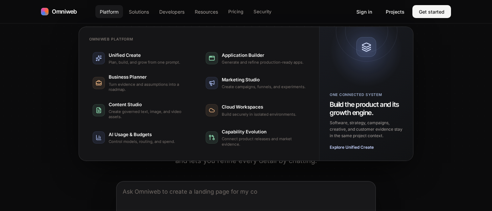
</p>

## Features

### Unified Create

`/create` is the main prompt surface. **Auto** mode detects every intent in a prompt;
explicit Build, Business, Marketing, Content, Image, Video, and Engineering modes are also
available.

- A LangGraph supervisor builds a dependency-aware task graph. Strategy runs before
  campaigns, and campaigns run before creative assets.
- Each plan shows its **risk level**, the **domains** involved, and the **approvals
  required** before anything consequential happens.
- Each task carries a structured **handoff** (authorized capabilities, output schema,
  acceptance criteria, token budget, risk, approval requirements).
- Each finished task stores a **quality record**: status, method, verification evidence,
  limitations, outstanding approvals, and next actions.

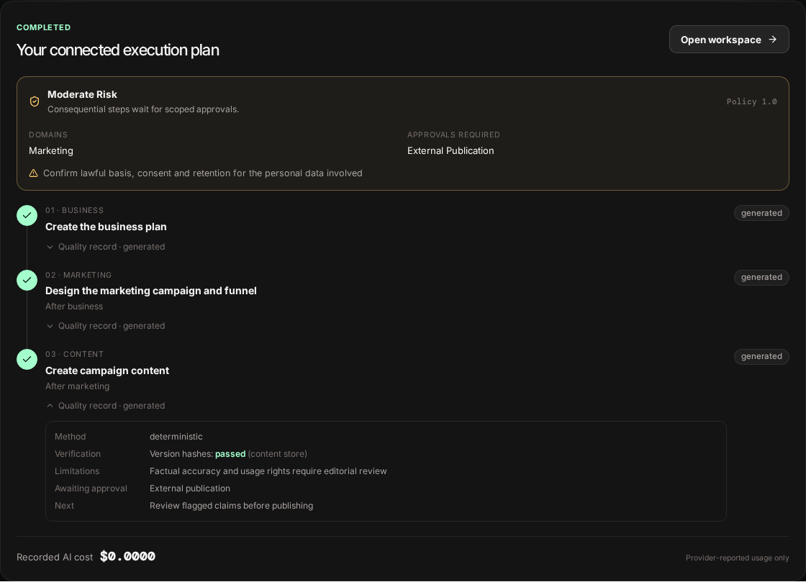

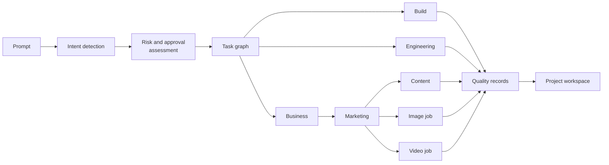

### Application builder and Studio

Describe an application and Omniweb generates real source code, checks it in a sandbox,
previews it, and lets you change it by chat, by hand, or by clicking the preview.

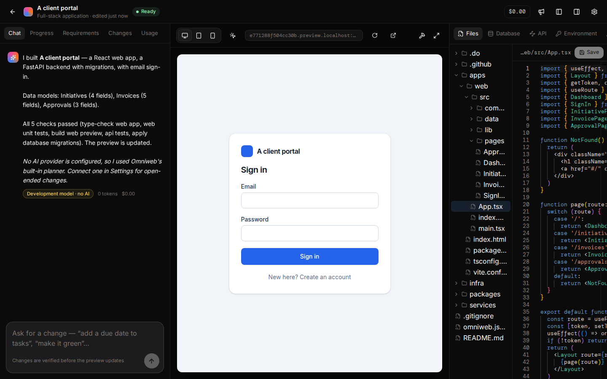

- **Left panel:** chat, build progress, requirements, Git checkpoints with diffs and
  undo/redo, and usage.
- **Centre:** live preview on desktop, tablet, and phone (web and Expo surfaces), with
  element selection for visual edits and an approval banner.
- **Right panel:** Monaco editor, database schema and migrations, API routes,
  environment variables, GitHub sync and deploys, and build logs.
- On phones the Studio shows one pane at a time.

Each build runs a LangGraph pipeline. The preview only advances to a commit whose checks
all passed; until then it keeps showing the last working version.

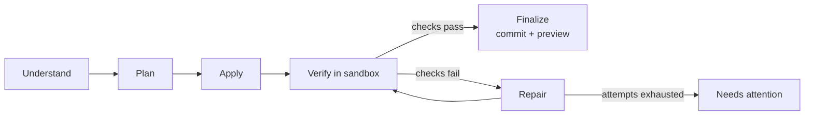

**What a build produces.** Each project is a Git repository rendered from a versioned
template and the app specification:

- `apps/web` — React, Vite, Tailwind, hash routes, Vitest tests
- `services/api` — FastAPI, SQLAlchemy, Alembic migrations, scrypt password auth, pytest
- `apps/mobile` — Expo / React Native, previewed through react-native-web
- `infra/`, `.do/app.yaml`, `.github/workflows` — deployment and CI files

Every check (type check, unit tests, web build, API tests, migrations, mobile bundle) runs
with no network, a cleared environment, and resource limits.

Without AI provider keys, the architect and editor agents fall back to a deterministic
planner that understands common requests ("add a due date to tasks", "remove the notes
field from clients", "add invoices", "make it green", "add sign-in", "add a mobile app").
Automatic repair of failing checks needs a provider.

### Growth workspace

`/projects/<id>/growth` keeps strategy, campaigns, funnels, blog and content work, CRM
leads, analytics, automations, and capability improvements in the same project as the
software.

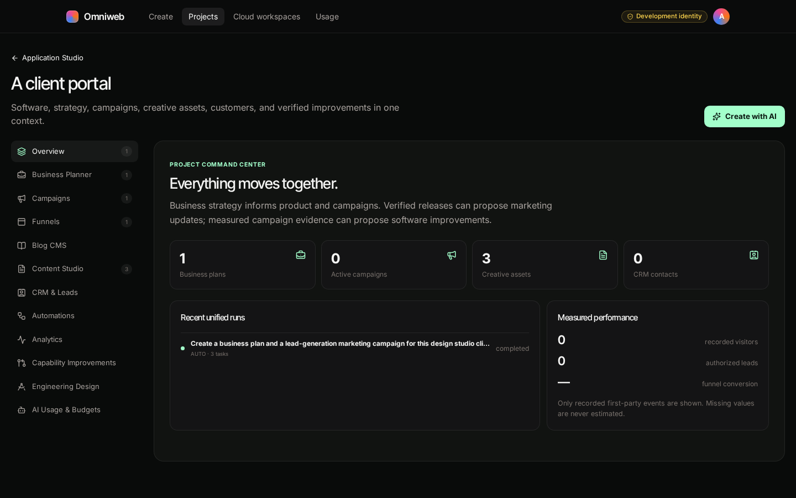

- Business plans separate **sourced claims** from **assumptions** and **projections**.
- Analytics show only recorded first-party events; missing values are never estimated.
- Publication, email sends, paid media, and ad spend are explicit approval gates.
- Forms record consent; email honours consent, unsubscribe, and suppression.

**Bidirectional capability evolution.** Authorized evidence from any domain can propose an
improvement in another, and every step is versioned and linked to its evidence.
Correlation is never labelled causation.

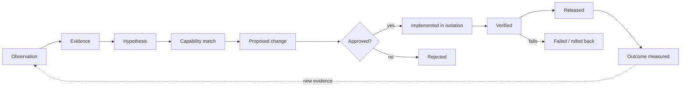

### Engineering Design

`/projects/<id>/engineering` is an integrated parametric mechanical-design workspace. It
produces genuine CAD geometry, not images of drawings.

<table>
  <tr>
    <td width="50%">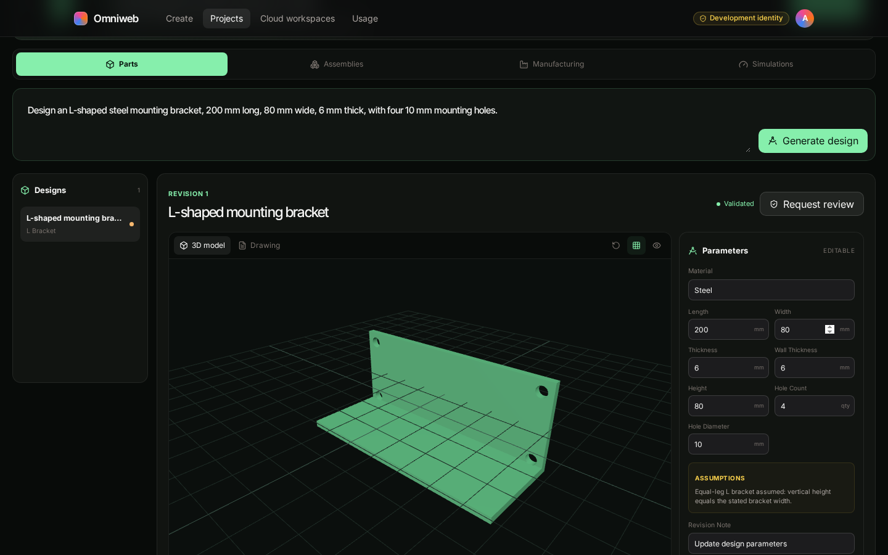</td>
    <td width="50%">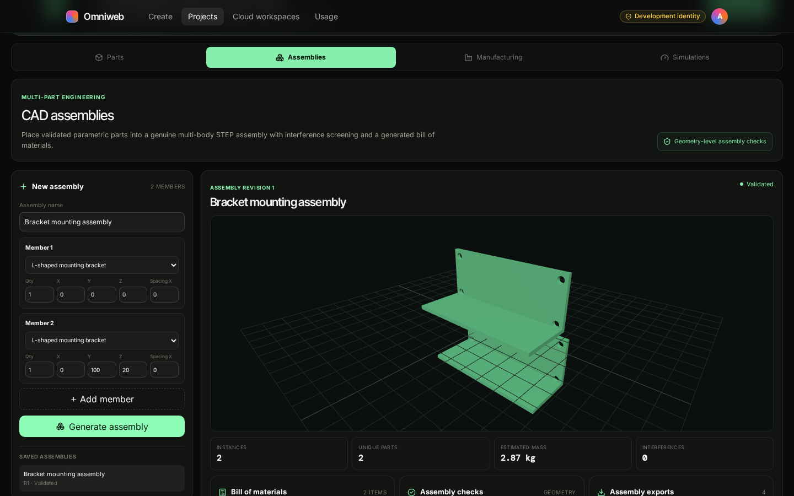</td>
  </tr>
  <tr>
    <td><b>Parts.</b> Natural-language requirements, editable parameters, interactive Three.js preview, immutable revisions.</td>
    <td><b>Assemblies.</b> Multi-body STEP assemblies with placement, bill of materials, and interference screening.</td>
  </tr>
  <tr>
    <td>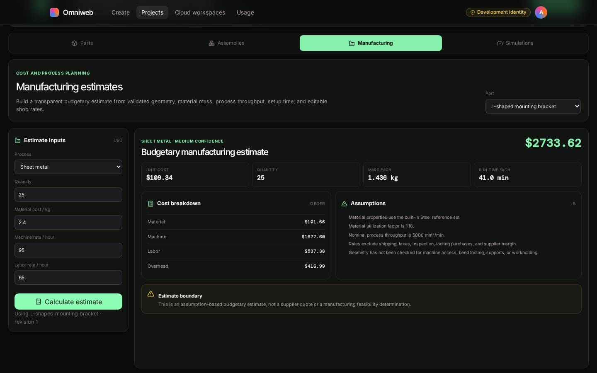</td>
    <td>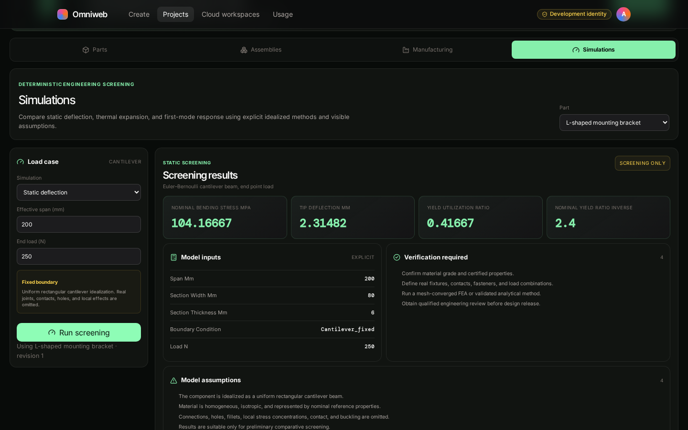</td>
  </tr>
  <tr>
    <td><b>Manufacturing.</b> Transparent budgetary estimates for sheet metal, CNC, laser cutting, and FDM, with editable rates.</td>
    <td><b>Simulations.</b> Static, thermal-expansion, and first-mode screening with explicit inputs, methods, and assumptions.</td>
  </tr>
</table>

[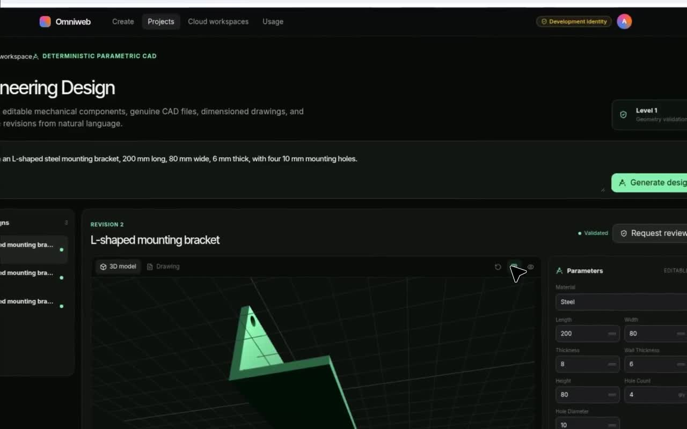](frontend/public/media/engineering-cad-workspace-walkthrough.mp4)

*Click the image to watch the Engineering CAD workspace walkthrough.*

- Supported components: plates, equal-leg L brackets, cylindrical spacers, and open-top
  enclosures, with holes and optional fillets.
- Exports: STEP, STL, PDF drawings, DXF, and the native parametric JSON source.
- The CAD service accepts validated declarative specifications only. It never executes
  user- or model-authored Python.

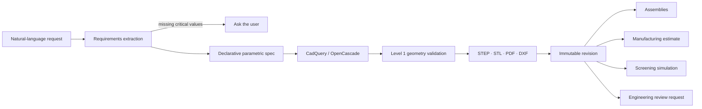

> Geometry validation is not structural analysis, code compliance, engineering
> certification, or approval for manufacturing. Manufacturing estimates are not supplier
> quotes. Screening calculations are not finite-element analysis.

### Cloud development environments

`/app` is a multi-tenant control plane for secure remote development workspaces in a
customer's DigitalOcean account. Users choose infrastructure, approve its estimated cost,
and open the workspace in a browser IDE or web console without managing SSH keys or public
VM addresses.

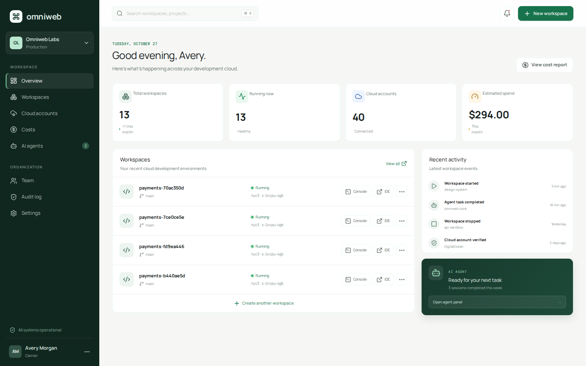

Infrastructure operations run in safe mock mode by default. No billable resource is
created without changing the configuration and providing an authorized, scoped
DigitalOcean token.

### AI usage, routing, and budgets

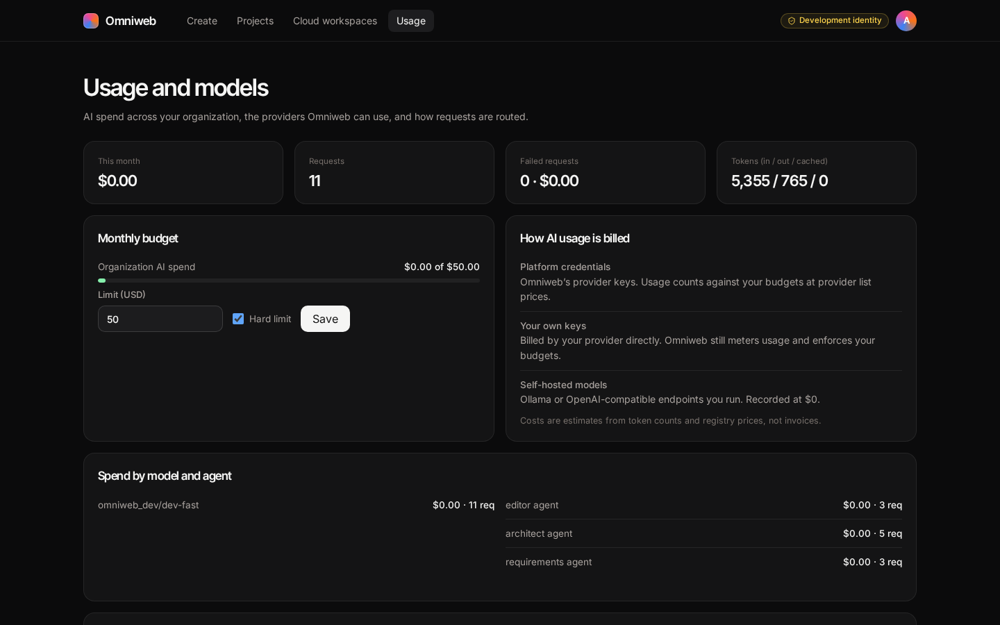

- **Model gateway** is the only component that holds provider keys. It supports OpenAI,
  Anthropic, Gemini, OpenRouter, OpenAI-compatible endpoints, and Ollama. Model IDs come
  from each provider's list-models API.
- **Adaptive AI Execution Engine (AAEE)** is the single cost-aware router. It uses
  deterministic tools first, then low-cost GPT-OSS/Grok routes, then hosted models,
  escalating on measured failure signals within a bounded ladder.
- Per-task, per-project, and monthly budgets have hard limits, a usage ledger, and
  cancellation.
- Without any provider key, chat replies come from a clearly labelled **development model**
  that makes no AI calls and costs $0.

### Website builder

The landing page also has a **Website** mode: describe a site and Omniweb generates a
responsive single-file website with a live preview at `/build/<projectId>`. Refine it by
chatting ("make it dark", "add an FAQ", "make it a restaurant"). Every change is a version
you can undo or redo, preview on desktop, tablet, or mobile, copy, or export. This designer
runs entirely in the browser and needs no API keys.

<p align="center">
  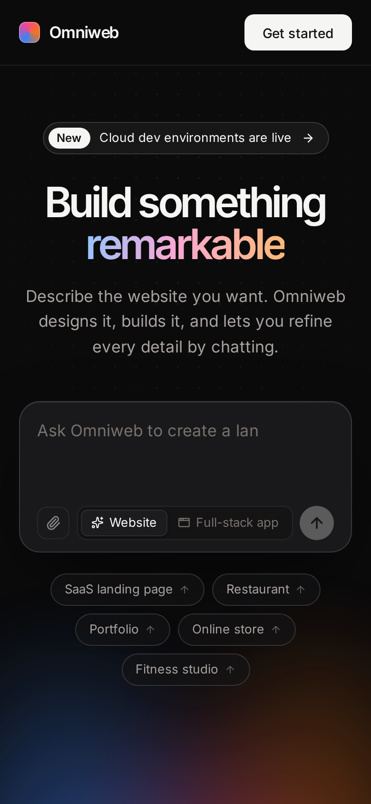
</p>

## Architecture

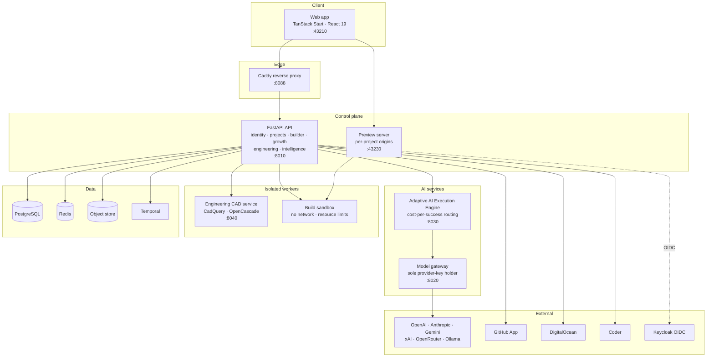

**Key decisions** (details in [`docs/`](docs/)):

1. **One control plane** for transactional domains. PostgreSQL in production; SQLite for
   deterministic local development and tests.
2. **Typed relational graph** for capability evolution. A graph database isn't justified
   by current queries.
3. **LangGraph supervisors** with persisted workflow and task state, so restarts and audits
   don't depend on in-memory graphs.
4. **One model router.** Every text task goes through AAEE; deterministic routing and
   templates run before any model call.
5. **Credential isolation.** Only the model gateway holds text-model keys. Media keys stay
   in server-side adapters and never reach browsers, generated apps, CDEs, prompts, or logs.
6. **Isolated execution.** Builds run in a sandbox; CAD runs in a non-root, read-only,
   resource-limited service with no external network.

### Request lifecycle with approvals

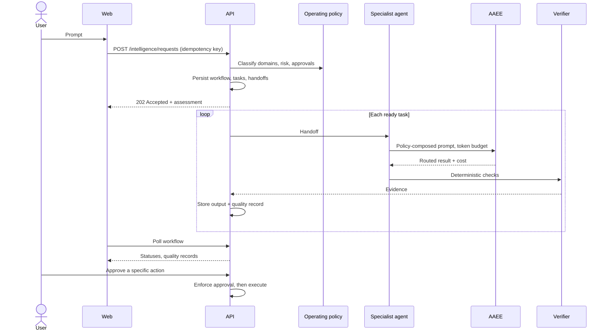

## Repository layout

```text
.
├── frontend/                    TanStack Start web app (React 19, Tailwind, Three.js, Monaco)
│   ├── src/routes/              Pages: landing, create, projects, studio, growth, engineering, usage, app
│   ├── src/lib/api.ts           Typed API client
│   ├── public/media/            Product walkthrough video and poster
│   └── e2e/                     Playwright browser tests
├── backend/                     FastAPI control plane
│   ├── app/builder/             LangGraph build pipeline, templates, sandbox, edits
│   ├── app/intelligence/        Unified Create supervisor and operating policy
│   ├── app/engineering/         CAD service client and durable job worker
│   ├── app/*_api.py             Projects, builder, growth, marketing, engineering, AI routes
│   ├── migrations/              Alembic migrations
│   └── tests/                   pytest suites
├── services/
│   ├── model-gateway/           Provider registry, routing tiers, budgets, usage ledger
│   ├── ai-execution-engine/     AAEE: classifier, planner, escalation, validation, analytics
│   └── engineering/             Deterministic CAD, drawings, assemblies, estimates, screening
├── infrastructure/              Coder template, cloud-init, Caddy, Keycloak, containers
├── assets/                      Product marks
├── docs/                        Architecture, operations, security, policy, ADRs, images
└── docker-compose.yml           Full local stack
```

## Quick start

### Prerequisites

- Node.js 20+ and npm
- Python 3.12
- git and util-linux `unshare` with unprivileged user namespaces (for builder sandboxes)
- Optional: Docker or Podman for the full Compose stack

### 1. Web app

```bash
cd frontend
npm install
npm run dev            # http://localhost:43210
```

The frontend uses representative local data when the API isn't running, so the
dashboards can be evaluated immediately.

### 2. API

```bash
cd backend
python3.12 -m venv .venv && . .venv/bin/activate
pip install -e '.[dev]'
alembic upgrade head
uvicorn app.main:app --reload --port 8010    # OpenAPI at http://localhost:8010/docs
```

Development mode uses SQLite, a seeded local organization, and mocked DigitalOcean and
Coder operations. Without `OMNIWEB_OIDC_ISSUER`, requests use a local development identity,
which the UI labels.

The first build installs the generated apps' shared npm and Python toolchain into
`<OMNIWEB_BUILDER_DATA_DIR>/toolchain`. That needs network access once.

### 3. Supporting services

Run each in its own terminal:

```bash
# Preview server: serves each project's last verified build on its own origin
(cd backend && uvicorn app.preview_server:app --host 127.0.0.1 --port 43230)

# Model gateway
(cd services/model-gateway && pip install -e '.[dev]' && uvicorn gateway.main:app --reload --port 8020)

# Adaptive AI Execution Engine
(cd services/ai-execution-engine && pip install -e '.[dev]' && uvicorn aaee.main:app --reload --port 8030)

# Engineering CAD service
(cd services/engineering && pip install -e '.[dev]' && uvicorn engineering.main:app --reload --port 8040)
```

| Service | Port | URL setting in the API |
| --- | --- | --- |
| Web app | 43210 | — |
| API | 8010 | — |
| Model gateway | 8020 | `OMNIWEB_MODEL_GATEWAY_URL` |
| AAEE | 8030 | `OMNIWEB_AAEE_URL` |
| Engineering CAD | 8040 | `OMNIWEB_ENGINEERING_SERVICE_URL` |
| Preview server | 43230 | `OMNIWEB_PREVIEW_URL` |

Browsers resolve `*.localhost` to loopback, so per-project preview origins work locally
without DNS. Elsewhere, point a wildcard DNS record at the preview server.

### 4. Full stack with Docker Compose

```bash
docker compose up --build    # http://localhost:8088
```

Includes PostgreSQL, Redis, Temporal, Keycloak, Coder, the model gateway, AAEE, the API,
the engineering service, the preview server, the web app, and Caddy. To sign in through
Keycloak instead of the development identity, set
`OMNIWEB_OIDC_ISSUER=http://localhost:8180/realms/omniweb` before building. Local passwords
are development defaults and must be replaced outside an isolated workstation.

> The Compose stack hasn't been run in this repository's development environment, which
> has no container runtime.

## Configuration

### Builder

| Variable | Default | Purpose |
| --- | --- | --- |
| `OMNIWEB_BUILDER_DATA_DIR` | `./.omniweb` | Project repositories, builds, previews, local GitHub stand-in |
| `OMNIWEB_BUILDER_TOOLCHAIN_DIR` | `<data>/toolchain` | Shared npm and Python packages for generated apps |
| `OMNIWEB_SANDBOX_MODE` | `namespace` | `namespace` (unshare), `container` (recommended for production), or `disabled` |
| `OMNIWEB_SANDBOX_TIMEOUT_SECONDS` | `300` | Per-check time limit |
| `OMNIWEB_PREVIEW_URL` | `http://localhost:43230` | Public base URL of the preview server |
| `OMNIWEB_PREVIEW_SUBDOMAINS` | `true` | One origin per project; `false` falls back to `/p/<token>/` paths |
| `OMNIWEB_MAX_REPAIR_ATTEMPTS` | `2` | Repair passes before a build needs attention |
| `OMNIWEB_GITHUB_APP_ID`, `OMNIWEB_GITHUB_APP_PRIVATE_KEY` | empty | Sync with github.com through a GitHub App; empty uses a local bare repository |
| `OMNIWEB_MOCK_INFRASTRUCTURE` | `true` | Deploys go to a mock App Platform; set `false` only with an authorized DigitalOcean token |

### AI services

| Variable | Purpose |
| --- | --- |
| `OMNIWEB_MODEL_GATEWAY_SECRET` / `GATEWAY_SERVICE_SECRET` | Shared service secret between API and gateway (must match) |
| `OMNIWEB_AAEE_SECRET` / `AAEE_SERVICE_SECRET` | Shared service secret between API and AAEE (must match) |
| `GATEWAY_OPENAI_API_KEY` (and Anthropic, Gemini, OpenRouter equivalents) | Platform-managed provider credentials |

Organization admins can also add their own keys under **Usage → Providers**.

### Media providers

Media adapters stay disabled until an administrator configures credentials, verifies model
access and pricing, and authorizes a job. Setup and tests never perform paid generation.

| Variable | Purpose |
| --- | --- |
| `OMNIWEB_OPENAI_MEDIA_API_KEY` | Server-only OpenAI media credential |
| `OMNIWEB_OPENAI_IMAGE_MODELS` | Admin-allowed image models |
| `OMNIWEB_OPENAI_VIDEO_MODELS` | Admin-allowed video models; empty means unavailable |
| `OMNIWEB_MEDIA_PRICING_JSON` | Operator-validated estimates used before authorization |
| `OMNIWEB_ASSET_DATA_DIR` | Object-store adapter data directory |

Unverified model names are never registered; unsupported features return a capability
status rather than a false promise.

## Testing

```bash
(cd backend && pytest && ruff check app tests && alembic check)
(cd services/engineering && pytest && ruff check .)
(cd services/model-gateway && pytest && ruff check .)
(cd services/ai-execution-engine && pytest && ruff check .)
(cd frontend && npm run typecheck && npm run build)

# Browser tests run against the dev servers above
(cd frontend && npx playwright install chromium && npm run test:e2e)
```

Browser coverage includes the landing navigation and marketing pages, mobile layouts,
app generation with preview and chat edits, Studio panels, write-only environment
variables, the usage page, Unified Create risk and quality records, and the engineering
parts, assemblies, manufacturing, and simulation workflows. CI uses mocked providers and
incurs no paid inference or media spend.

## Safety and governance

Omniweb runs under a versioned operating policy
([`docs/operating-policy.md`](docs/operating-policy.md)). Model instructions are guidance,
not a security boundary: authorization, approvals, budgets, and execution limits are
enforced in code.

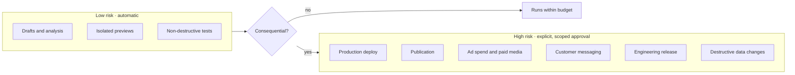

**Completion statuses** are reported only as far as evidence supports:
`proposed → generated → tested → verified → approved → deployed`.

What the platform enforces:

- **Tenancy.** Organization and project claims come from authenticated principals or
  signed service tokens, never request bodies.
- **Prompt injection.** User and retrieved content is delimited as untrusted data;
  override phrases raise risk and are recorded.
- **Builder safety.** Data-deleting migrations wait for approval. Hand-edited files are
  never overwritten. Every deploy and rollback needs approval, and production also needs
  the owner to type the project name. Agents can't approve their own requests.
- **Preview isolation.** Each project's preview runs on its own origin with a strict CSP.
- **Git safety.** Sync never force-pushes, refuses to push over newer remote commits, and
  stops on conflicts. GitHub App tokens are short-lived and never written to repositories.
- **Secrets.** Provider tokens are encrypted before storage and never returned.
- **Engineering boundaries.** CAD and analysis outputs carry explicit validation levels
  and safety notices. Safety-critical or regulated requests are escalated for qualified
  professional review.
- **Costs.** Figures are estimates. Provider and DigitalOcean billing are authoritative,
  and stopped resources can still incur charges.

## Documentation

| Document | Contents |
| --- | --- |
| [Platform plan](docs/platform-plan.md) | Service boundaries and milestone status |
| [Architecture](docs/architecture.md) | DigitalOcean CDE decision, workspace state, trust boundaries |
| [Unified intelligence](docs/unified-intelligence-architecture.md) | Business, marketing, creative, and capability-evolution design |
| [Engineering Design Agent](docs/engineering-design-agent.md) | CAD service contracts, isolation, validation levels, tests |
| [Operating policy](docs/operating-policy.md) | What code enforces versus model guidance |
| [ADR 0001](docs/adr/0001-adaptive-ai-execution-engine.md) | Adaptive AI Execution Engine decision |
| [Security](docs/security.md) · [Security results](docs/security-results.md) | Security model and verification results |
| [Deployment](docs/deployment.md) · [Runbook](docs/runbook.md) | Operating the platform |
| [Integration notes](docs/integration-notes.md) | Verified Coder, DigitalOcean, and model-provider notes |
| [Known limitations](docs/known-limitations.md) | Current gaps |

## Known limitations

- Infrastructure runs in mock mode by default; real DigitalOcean provisioning needs an
  authorized token and configuration changes.
- Automatic repair of failing builds needs an AI provider key.
- Engineering supports four component families and Level 1 geometry validation. Assembly
  checks don't validate mates, joints, fasteners, fits, or load transfer. Simulations are
  analytical screening only.
- Risk and regulated-category detection is keyword based; it triggers review and isn't a
  legal, regulatory, or engineering determination.
- Video generation stays unavailable until a provider account and endpoint are verified.

See [`docs/known-limitations.md`](docs/known-limitations.md) for the full list.
